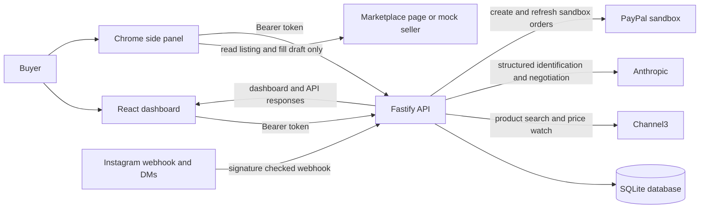
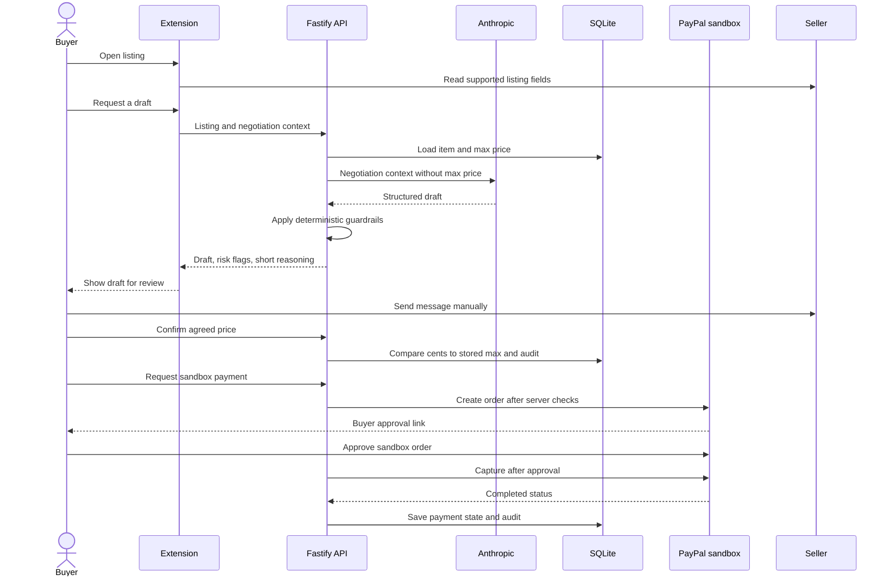

# Fargain architecture

## System overview

## Trust boundaries

1. **Browser clients are untrusted.** Request bodies and query parameters are validated with shared or route-local Zod schemas. API authentication is bearer-token based. Price limits are loaded from SQLite and enforced on the server.
2. **Seller text and product content are untrusted.** The negotiation agent treats seller messages and product captions as data. Deterministic guardrails check drafts, buyer-approved messages, off-platform payment requests, budget probes, and scam language.
3. **LLM output is untrusted.** Structured output is parsed and validated. The agent does not receive `max_price`; its responses are checked again by server guardrails.
4. **Provider callbacks are untrusted.** Meta webhook requests are signature checked from raw bytes. PayPal webhooks are verified with PayPal before their events are acted on.
5. **Money leaves only through PayPal sandbox.** A user confirms the agreed price, the backend enforces the max, and PayPal still requires buyer approval before capture. No live endpoint is configured.

## Negotiation and payment sequence

## Data ownership

SQLite is the source of truth for wishlist items, user profile, price snapshots, alerts, negotiations, messages, payment state, Reel sessions, processed webhook message IDs, and audit events. Each dashboard query is scoped to the single default user. The Render blueprint mounts the database under `/var/data` so restarts do not erase the file.

The `shared/` package holds schemas and domain types used across the API and extension. Database migrations are append-only in `backend/src/db/migrations.ts`. Provider-specific transport code is isolated under `backend/src/pricing`, `backend/src/payments`, and `backend/src/reels`.

## Deployment shape

Render builds the shared package, backend, and dashboard. The Fastify process serves the dashboard build from `dashboard/dist` and serves the mock seller from `/mock-seller/`. Vite serves the dashboard on port 5173 during local development and proxies `/api` to the backend on port 3000. The extension is built separately because Chrome loads it as an unpacked extension or a packaged extension, not as part of the backend web app.
